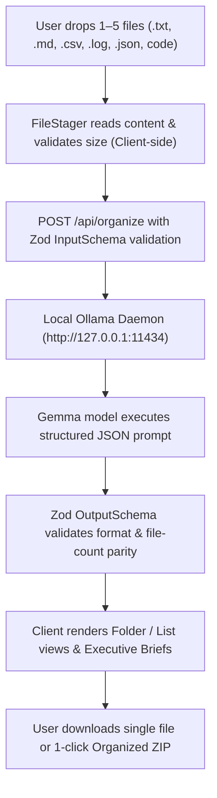

# ✦ LazyDesk AI

> **Privacy-first, local AI desktop file organizer, categorizer, and executive summarizer powered by Google Gemma and Ollama.**

[](https://nextjs.org/)
[](https://react.dev/)
[](https://www.typescriptlang.org/)
[](https://tailwindcss.com/)
[](https://ollama.ai/)
[](https://github.com)

---

## 📖 Overview

**LazyDesk AI** is an intelligent desktop companion engineered to eliminate file clutter without compromising privacy. Drop your unorganized downloads, scattered project notes, receipts, debug logs, or code snippets into LazyDesk AI. Running completely on your local machine using **Ollama** and **Gemma**, LazyDesk inspects file contents, classifies them into structured folders, generates safe, descriptive filenames, and extracts crisp executive summaries.

Once organized, download individual files or export the entire organized directory structure as a clean, ready-to-unzip archive.

---

## ✨ Key Features

- 🧠 **100% Local AI Intelligence**: Powered by local Gemma models (`gemma4:e2b`) via Ollama (`http://127.0.0.1:11434`). No API keys, no subscriptions, and zero external network calls.
- 🔒 **Zero-Cloud Privacy Guarantee**: File contents remain on your computer. Text is processed ephemerally in RAM and prompts enforce strict untrusted data boundaries.
- 🗂️ **Intelligent Categorization & Renaming**: Automatically detects context and categorizes files into directories (e.g., `Work/`, `Personal/`, `Development/`, `Study/`, `Other/`) with standardized, clean filenames while preserving original file extensions.
- 📋 **Executive Document Briefs**: Distills dense documents, transcripts, and logs into factual 1–2 sentence bullet briefs for fast decision-making.
- 📦 **1-Click ZIP Packaging**: Seamlessly generates and downloads organized directory trees right inside the browser via JSZip.
- 🌌 **Futuristic Cyberpunk Interface**:
  - Interactive **3D Celestial Orb** with ambient glow & specular highlights.
  - **Focus Score & Declutter Metrics** to track productivity.
  - **Activity Timeline** detailing past actions and decluttering velocity.
  - **Automations Rules Manager** to review active background workflows.
- 🛡️ **Defensive Schema Validation**: Built with strict [Zod](https://zod.dev/) schemas, file size validation (max 500 KB per text file), character caps (12,000 characters per file), and payload timeouts.

---

## 🛠️ Tech Stack

| Layer | Technology |
| :--- | :--- |
| **Framework** | [Next.js 16 (App Router)](https://nextjs.org/) |
| **UI Library** | [React 19](https://react.dev/) |
| **Styling** | [Tailwind CSS v4](https://tailwindcss.com/) |
| **Language** | [TypeScript 5](https://www.typescriptlang.org/) |
| **AI Inference** | [Ollama](https://ollama.ai/) + [Gemma (gemma4:e2b)](https://ollama.com/library/gemma) |
| **Schema Validation** | [Zod 4](https://zod.dev/) |
| **Client Compression**| [JSZip](https://stuk.github.io/jszip/) |

---

## 🚀 Getting Started

### Prerequisites

1. **Node.js** (v18.18.0 or higher recommended)
2. **npm**, **pnpm**, or **yarn**
3. **Ollama**: Download and install from [ollama.ai](https://ollama.ai)

### 1. Set Up Local Ollama Model

Ensure Ollama is running, then pull the Gemma model configured for LazyDesk AI:

```bash
ollama pull gemma4:e2b
```

> **Note**: Verify Ollama is listening locally by visiting `http://127.0.0.1:11434` or running `curl http://127.0.0.1:11434`.

### 2. Clone and Install Dependencies

```bash
git clone https://github.com/hamzaraj9121/lazydesk-ai.git
cd lazydesk-ai
npm install
```

### 3. Run the Development Server

```bash
npm run dev
```

Open [http://localhost:3000](http://localhost:3000) in your browser.

---

## 📂 Project Structure

```text
lazydesk-ai/
├── app/
│   ├── api/
│   │   └── organize/
│   │       └── route.ts         # Serverless endpoint calling local Ollama daemon
│   ├── favicon.ico              # App favicon
│   ├── globals.css              # Tailwind CSS v4 styling & theme configuration
│   ├── layout.tsx               # Root application layout with Geist fonts
│   └── page.tsx                 # Main application controller & state coordinator
├── components/
│   ├── dashboard/               # Main assistant dashboard widgets
│   │   ├── ActivityTimeline.tsx # Organization scan timeline & recent actions
│   │   ├── AutomationsWidget.tsx# Desktop workflow rules summary
│   │   ├── CelestialOrb.tsx     # 3D interactive glowing orb visualization
│   │   ├── DashboardView.tsx    # Primary dashboard view orchestrator
│   │   ├── ExecutiveBriefWidget.tsx # Highlights of recent document summaries
│   │   ├── FocusScoreWidget.tsx # Productivity score & desktop health gauge
│   │   └── SummaryWidget.tsx    # Batch organization overview card
│   ├── layout/                  # Shell components
│   │   ├── Footer.tsx           # Global app footer & privacy badge
│   │   ├── Header.tsx           # Top status bar & view breadcrumbs
│   │   └── Sidebar.tsx          # Icon sidebar navigation bar
│   ├── sections/                # Core organizer workflows
│   │   ├── ErrorAlert.tsx       # Dismissible feedback & alert banner
│   │   ├── FileStager.tsx       # Drag-and-drop staging area & batch runner
│   │   ├── HeroSection.tsx      # Organizer intro & value proposition
│   │   └── ResultsSection.tsx   # Folder/List views with ZIP export actions
│   ├── ui/                      # Reusable atom components
│   │   ├── CategoryBadge.tsx    # Color-coded folder category badges
│   │   ├── ResultCard.tsx       # Card rendering sanitized file & summary
│   │   └── StagedFileCard.tsx   # Staged file item with preview modal
│   └── views/                   # Secondary tabs
│       ├── AutomationsView.tsx  # Full rules & triggers configuration
│       ├── SettingsView.tsx     # Local AI engine & privacy diagnostics
│       └── SummariesView.tsx    # Executive document dossier & copy deck
├── lib/
│   ├── api.ts                   # Client-side API fetch abstraction
│   ├── constants.ts             # App limits, batch sizes & sample documents
│   ├── types.ts                 # TypeScript interfaces and union types
│   ├── utils.ts                 # Category color logic, single & ZIP export helpers
│   └── validation.ts            # Zod validation schemas for input & output
├── next.config.ts               # Next.js configuration
├── package.json                 # Project dependencies & scripts
├── tsconfig.json                # TypeScript compiler configuration
└── README.md                    # Project documentation
```

---

## ⚙️ How It Works



1. **File Ingestion**: Users drag and drop or load sample text files. The client enforces a 5-file batch limit and trims files exceeding 12,000 characters.
2. **Schema Validation**: The request is verified on the server using Zod to ensure strict structure and prevent prompt tampering.
3. **Local Inference**: The server queries Ollama with a system prompt instructing the model to treat contents strictly as untrusted data and respond exclusively in JSON.
4. **Parity Check**: The response is parsed and validated: every submitted file must receive exactly one category, suggested sanitized name, and factual summary.
5. **Direct Export**: Users can inspect the categorization in Folder or List mode, copy summaries, and export organized files directly into subdirectories bundled inside a ZIP file.

---

## 📋 Supported File Types

LazyDesk AI organizes plain text, data, and code formats including:
- **Documents & Notes**: `.txt`, `.md`, `.markdown`
- **Structured Data**: `.csv`, `.json`, `.yaml`, `.yml`
- **System & Diagnostic**: `.log`
- **Code & Scripts**: `.js`, `.ts`, `.tsx`, `.py`, `.html`, `.css`

---

## 🛡️ Security & Privacy Guarantees

- **No Third-Party Transmission**: File contents never leave `127.0.0.1`.
- **Ephemeral RAM Processing**: Files are read into memory for processing and are never stored in a cloud database.
- **Untrusted Data Boundary**: Prompts explicitly command the AI engine to treat user file content as inert data, preventing prompt injection attacks.
- **Client-Side ZIP Generation**: Folder packaging occurs directly in your browser using Web Workers and Blob URLs.

---

## 📜 Available Scripts

| Command | Description |
| :--- | :--- |
| `npm run dev` | Starts the Next.js development server with hot reloading. |
| `npm run build` | Compiles and builds the production bundle. |
| `npm run start` | Launches the compiled production application. |
| `npm run lint` | Runs ESLint checks across the codebase. |

---

## 🤝 Contributing

Contributions, feedback, and suggestions are welcome!

1. Fork the repository
2. Create a feature branch (`git checkout -b feature/amazing-feature`)
3. Commit your changes (`git commit -m 'Add amazing feature'`)
4. Push to the branch (`git push origin feature/amazing-feature`)
5. Open a Pull Request

---

## 📄 License

This project is licensed under the [MIT License](LICENSE).
